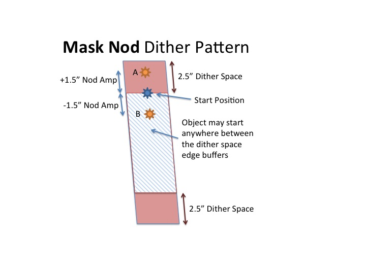
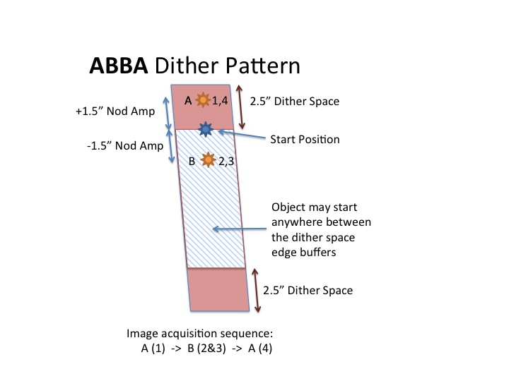
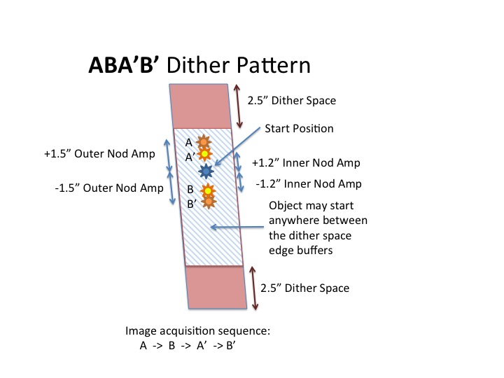
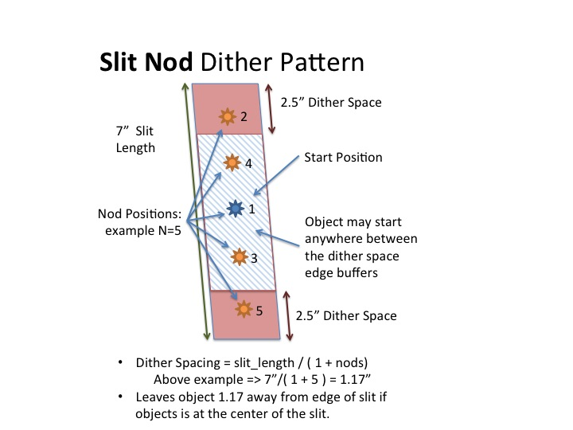
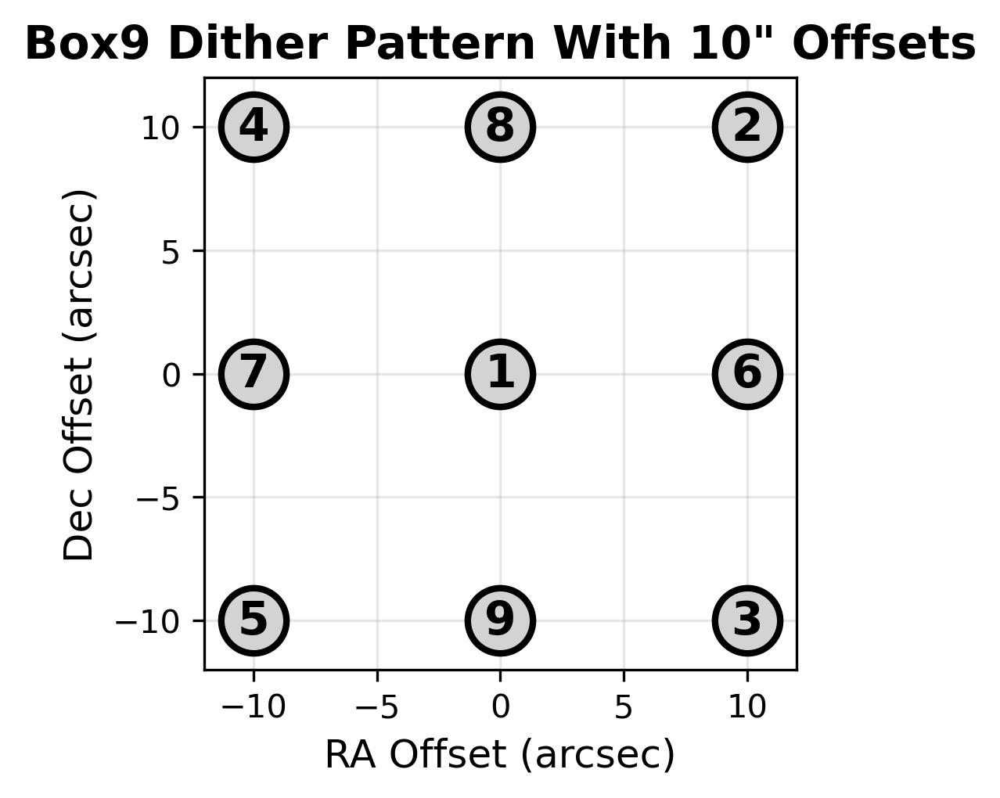
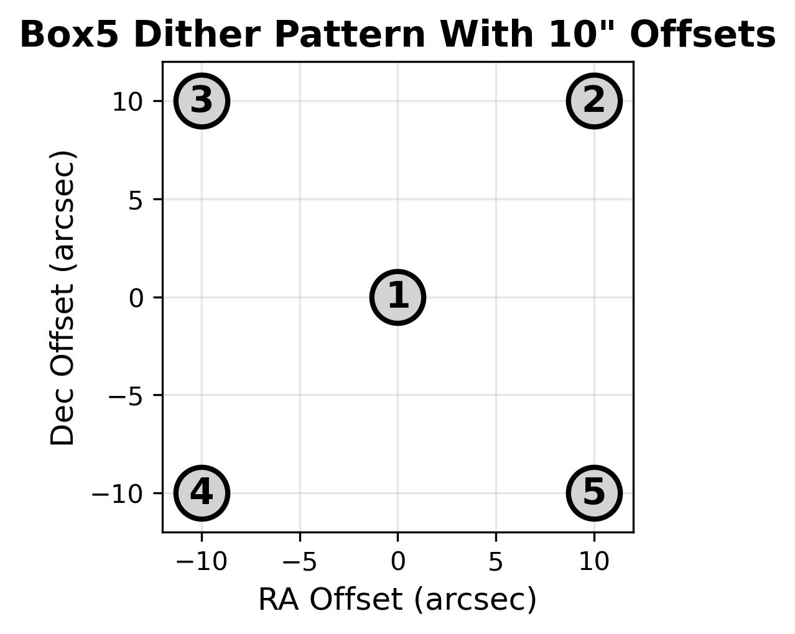
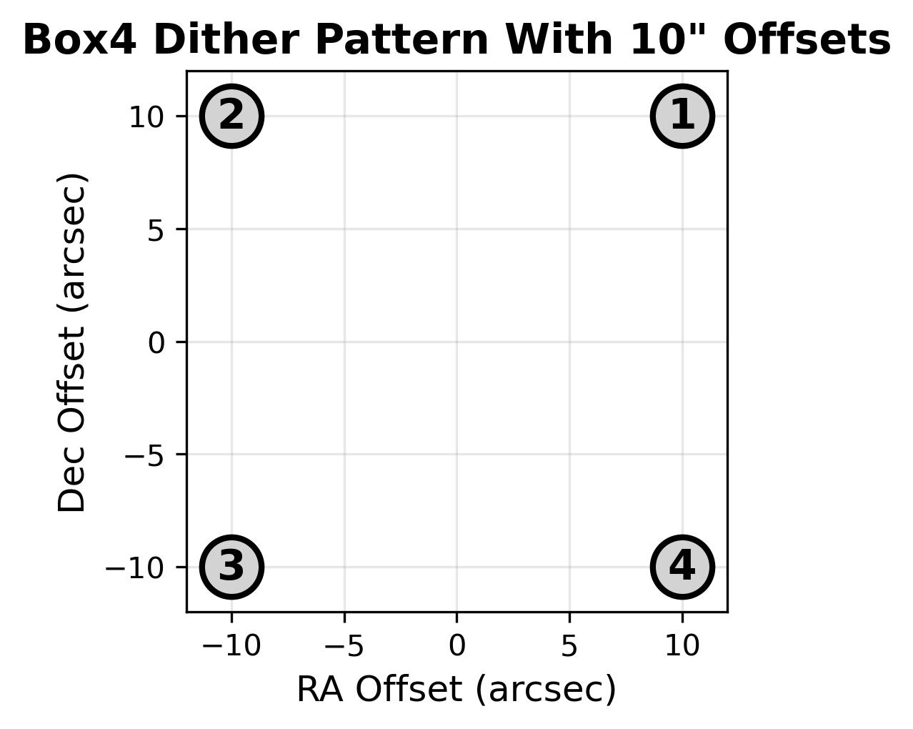

# Spectroscopic Dither Patterns

For spectroscopic observers there are four dither patterns available by default.

## Mask Nod

This is a two point dither pattern. The nod amplitude is the +/- offset from the center position. Typical nod amplitudes are 1-1.5 arcsec. A sequence of images move ABABABAB. This pattern is typically used when exposure times are relatively long 1-3 min.

## ABBA

This is a two point dither pattern but the pattern acquired two observations at the same position before moving to the next object. Typical nod amplitudes are 1-1.5 arcsec. The nod amplitude is the +/- offset from the center position. A sequence of images move ABBAABBAABBAABBA. This pattern is typically used when acquiring relatively bright objects such as standards where observations are short relative to the time required to offset the telescope (5-10 sec). 

## ABA'B'

This is a four point dither pattern. Typical nod amplitudes are 1.5 and 1.2 arcsec for the outer and inner nod amplitudes, respectively. The nod amplitude is the +/- offset from the center position. A sequence of images move ABA'B'ABA'B'. This pattern is typically used when exposure times are relatively long 1-3 min. Observers who use this pattern employ it because the literature suggests an improvement in the signal-to-noise over a simple AB dither pattern. 

## Slit Nod

This is an N point dither pattern. The nod amplitudes are set by the slit length and the desired number of nods. The above image shows an example of a 5 point dither pattern in a 7arcsec long slit. This pattern is typically used when exposure times are relatively short with standard stars (5-10 sec). An advantage is that the star does not land on the same rows of pixels which can lead to persistence issues. 

# Imaging Dither Patterns

Observers may use the imaging dither patterns for dithering or mosaicing, depending on the size of the dither requested. Imaging dithers are available in the dither drop down menu on the MOSFIRE Desktop, or can be called on the command line with some additional steps described in Imaging [Observing Sequences](workflow.md).

## box9

This is a 9 point dither pattern with a varying amplitude (set on the MOSFIRE Desktop or command line). The sequence of dithers is as shown in the image, starting at the central dither. For most imaging, this sequence alone can be used to construct a sky-based flat field, but for fields with highly extended targets, a sky offset is recommended. 

## box5

This sequence is the same as box9 but with fewer dithers, only toward the vignetted corners of the detector.

## box4

This sequence is the same as box9 and box5, but with no central dither position. Instead the script moves immediately to the four points of the dither pattern without the central exposure. 
