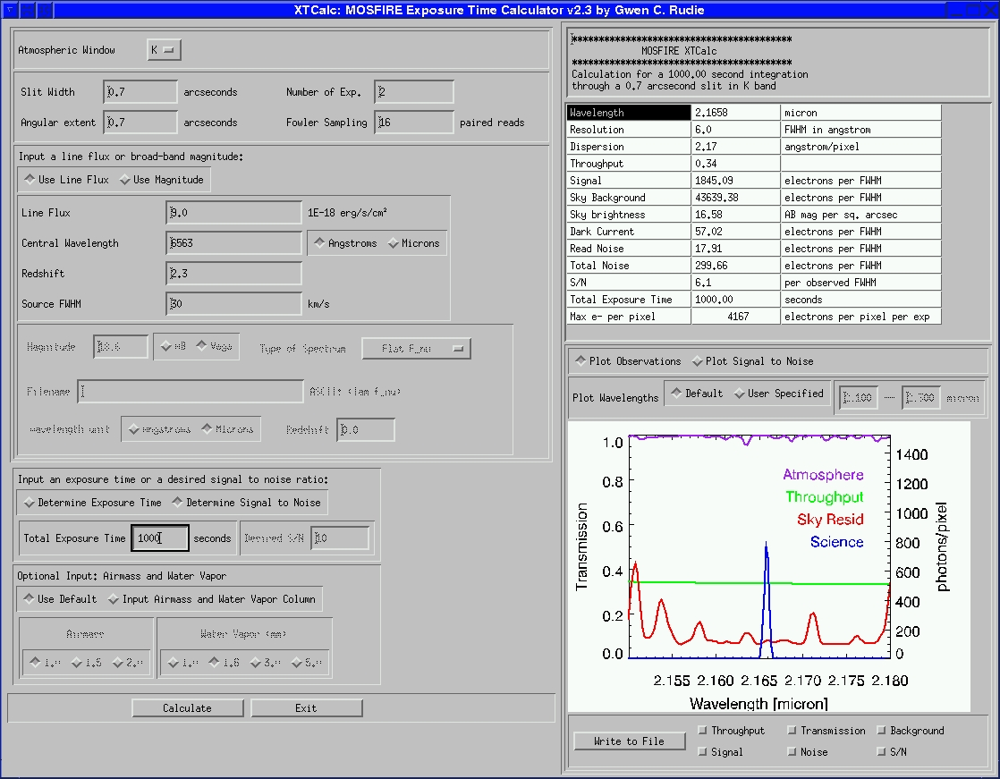

# Exposure Time Calculator

MOSFIRE XTcalc is a gui based exposure time calculator written in IDL. The software was written by MOSFIRE team member Gwen Rudie, and it folds in sensitivity and throughput measurements from MOSFIRE commissioning data obtained during the 2012A semester. The code is written in IDL, but you do not need IDL to run the calculator. It may be run with the IDL Virtual Machine. See below for details on how to install and run on your machine. 

### Known Bug

A bug has been uncovered in the XTcalc code and is documented here: [https://github.com/pypeit/keck-etcs/blob/keck-mosfire/docs/XTcalc_bug.md](https://github.com/pypeit/keck-etcs/blob/keck-mosfire/docs/XTcalc_bug.md)

There is also an early draft of an alternate ETC, but it is preliminary and does not support all modes yet: [https://keck-etcs.readthedocs.io/en/keck-mosfire/](https://keck-etcs.readthedocs.io/en/keck-mosfire/)

###  Installing and running XTcalc using the IDL Virtual Machine (default method) 

1. Download [XTcalc.tar](figures/XTcalc.tar)
2. Untar XTcalc.tar (e.g. `tar -xvf XTcalc.tar`). Contents will untar into a single directory.
3. Set a path variable called `MOSFIRE_XTCALC` to the full path of the XTCalc directory: e.g. `setenv MOSFIRE_XTCALC fullpath/XTcalc_dir` or in bash shell `export MOSFIRE_XTCALC=fullpath/XTcalc_dir`.
4. Optionally set a path variable called `MOSFIRE_WD` for input and output files. If it is not set, the default is to use the directory specified by `MOSFIRE_XTCALC`.
5. Download and install the IDL virtual machine. This may require you to register with the web site.
6. Run XTCalc: on the command line using `idl -vm=run_XTcalc.sav`

### Installation and Running XTcalc using IDL 8.0 or higher 

1. Download [XTcalc.tar](figures/XTcalc.tar)
2. Untar XTcalc.tar (e.g. `tar -xvf XTcalc.tar`). Contents will untar into a single directory.
3. Set a path variable called `MOSFIRE_XTCALC` to the full path of the XTCalc directory: e.g. `setenv MOSFIRE_XTCALC fullpath/XTcalc_dir` or in bash shell `export MOSFIRE_XTCALC=fullpath/XTcalc_dir`.
4. Start the IDL session
5. The procedures are located in ~XTCalc_dir/bin in the unpacked tar file. In the IDL session run:

```
.r run_XTcalc
.r XTcalc
.r events_XTcalc
run_XTcalc
```

### Troubleshooting

Symptom:
```
libGL error: No matching fbConfigs or visuals found
libGL error: failed to load driver: swrast
% Attempt to call undefined procedure: 'XMANAGER'.
% Execution halted at: RUN_XTCALC        511
```

Problem: Library mismatch 

Solution: set the LIBGL_ALWAYS_INDIRECT envar to 1

```
bash: export LIBGL_ALWAYS_INDIRECT=1
csh: setenv LIBGL_ALWAYS_INDIRECT 1 
```

# Using XTCalc

Below is a screen grab of the XTCalc Gui following a calculation for an emission feature. A [PDF](figures/MOSFIRE_XTcalc.pdf) describes installation and use of XTcalc. 


