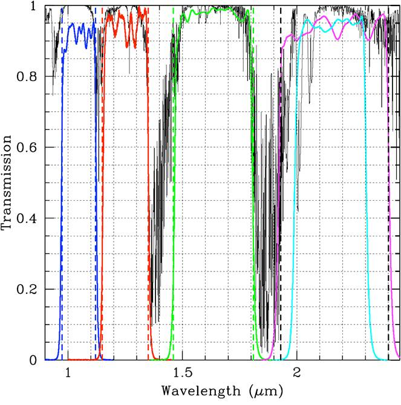
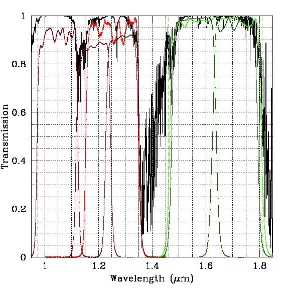

# Filters

s## Order Sorting Filters

| Name | Transmission Curve | &lambda;C (&mu;m) | FWHM (&mu;m) | Notes |
| ---- | ------------------ | ---------------------------- | ------------ | ----- |
| Y    | [Plot](figures/Y_band.jpg), [ASCII](figures/mosfire_Y.txt)  | 1.048 | 0.152 | |
| J    | [Plot](figures/J_band.jpg), [ASCII](figures/mosfire_J.txt)  | 1.253 | 0.200 | J2 covers a region that J does not. |
| H    | [Plot](figures/H_band.jpg), [ASCII](figures/mosfire_Y.txt)  | 1.637 | 0.341 | |
| K    | [Plot](figures/K_band.jpg), [ASCII](figures/mosfire_Y.txt)  | 2.162 | 0.483 | Not intended for imaging|
| Ks   | [Plot](figures/Ks_band.jpg), [ASCII](figures/mosfire_Y.txt) | 2.147 | 0.314 | |

## Intermediate Band Filters

| Name | Transmission Curve | &lambda;C (&mu;m) | FWHM (&mu;m) | Notes |
| ---- | ------------------ | ---------------------------- | ------------ | ----- |
| J2   | [Plot](figures/J2.jpg), [ASCII](figures/J2_center_corr.txt) | 1.181 | 0.129 | |
| J3   | [Plot](figures/J3.jpg), [ASCII](figures/J3_center_corr.txt) | 1.288 | 0.122 | |
| H1   | [Plot](figures/H1.jpg), [ASCII](figures/H1_center_corr.txt) | 1.556 | 0.165 | |
| H2   | [Plot](figures/H2.jpg), [ASCII](figures/H2_center_corr.txt) | 1.709 | 0.167 | |

## Broadband Filter Curves

> Image showing the broadband filter curves.

> Image showing the transmission curves of the J2,J3,H1, & H2 filters relative to the order sorting filters. 
