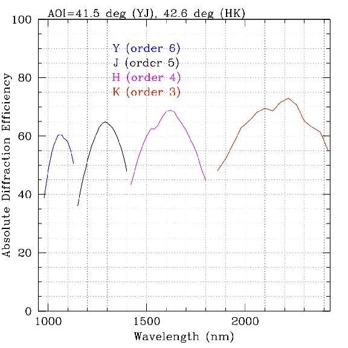

# Grating Specifications

The table below shows the efficiency of the grating only at orders 3, 4, 5, & 6 used with K, H, J, & Y filters, respectively. The efficiencies provided below are determined for the appropriate grating tilt used in MOSFIRE to selected the desired orders.

| Order | Band | Dispersion (&#197;/pix) | &lambda;c (&#197;) | R | &Delta;&lambda; (&#197;) | Slit Shifts (&#197;/mm) |
| ----- | ---- | ---------- | ------ | ---- | ----------- | ----- |
| 6     | Y    | 1.0855     | 10373  | 3388 | 9716-12250  | 6.216 |
| 5     | J    | 1.3028     | 12450  | 3318 | 11650-13520 | 7.460 |
| 4     | H    | 1.6269     | 16321  | 3660 | 15280-18090 | 9.157 |
| 3     | K    | 2.1691     | 21760  | 3610 | 20340-24060 | 12.209 |

- Central wavelength for a slit at the center of the field.
- For a nominal 0.7 arcsec slit
- Shift of the central wavelength (Å) per ΔX=1mm at the CSU (1.379 arcsec in the telescope focal plane). 

## Grating Efficiency Curves

## Individual Efficiency Curves

| Order | Band | Efficiency Curve |
| ----- | ---- | ---------------- |
| 6     | Y    | [Plot](figures/grating_Y.jpg), [ASCII](figures/Yavg.txt) |
| 5     | J    | [Plot](figures/grating_J.jpg), [ASCII](figures/Javg.txt) |
| 4     | H    | [Plot](figures/grating_H.jpg), [ASCII](figures/Havg.txt) |
| 3     | K    | [Plot](figures/grating_K.jpg), [ASCII](figures/Kavg.txt) |
