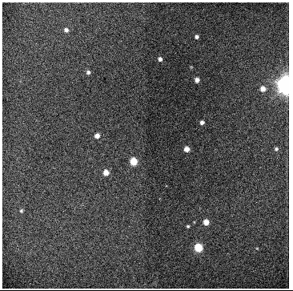

# MOSFIRE Guider

| Guider Properties | |
| --- | --- |
| Type | Offset |
| Pixel Scale (arcsec/pix) | 0.164 |
| FOV (arcsec) | 167 x 167 |
| PA Offset | 90 | 
| Zero Point | I=27.8 |
| Sensitivity | I=18.7 |

# Sensitivity / Zero Point

The MOSFIRE guider imaging zero point is presented below. The guider is equipped with a long pass OG750 filter and the long wavelength cutoff is defined by the detector QE. Known I-band standards in the m67 open cluster were used to calibrate the zero point. The ZP is defined to be the magnitude of a 1 ADU detection in 1 second of integration.

The photometry used for calibration comes from Yadav et al. A&A 484, 609. In the table below, the stars used in the measurements are listed along with the flux and sky background measured in the 1s image. The guider image was acquired using a gain setting of 0 => gain= 0.7 e-/ADU.The MOSFIRE guider image used was centered at: 8:51:11.95 11:54:12.3 and had a pa of -30. A finder chart of the field is shown below. The data were acquired during a full moon night.

The average zero point for the stars below was 28.1 I-band mag. The calculation assumed the standard Mauna Kea extinction value of 0.07 mag/airmass (Gemini).

The sensitivity for the guider for a 1 second exposure was calculated. For this calculation, the objects are assumed to be measured in a 1 arcsec aperture, with the sky background measured in an additional 1 arcsec aperture. The pixel scale was assumed to be 0.164 arcsec/pix for this calculation. For a S/N=10, the guider would detect an 18.9 mag object in a 1 second integration. 

```
    _RAJ200     _DEJ200                 Bmag e_Bmag   Vmag e_Vmag  Icmag _Icmag 
0 ("h:m:s") 0 ("d:m:s")    recno  Seq  (mag)  (mag)  (mag)  (mag)  (mag)  (mag) Flux    sky/pix		
----------- ----------- -------- ---- ------ ------ ------ ------ ------ ------ ------  -------
08 51 06.37 +11 54 18.8     1616 1616 20.025  0.094 18.245  0.017 16.116  0.016 76944   785
08 51 08.27 +11 54 19.9     1618 1618 17.342  0.011 16.715  0.008 15.959  0.005 76927   772
08 51 10.67 +11 54 34.2     1634 1634 17.316  0.011 16.319  0.010 15.208  0.006 163328  770
08 51 12.13 +11 54 40.4     1642 1642 16.025  0.005 15.255  0.005 14.419  0.003 321501  777
08 51 12.29 +11 54 23.0     1622 1622 14.788  0.004 14.156  0.002 13.459  0.004 762677  773
08 51 12.92 +11 53 52.3     1567 1567 16.362  0.006 15.529  0.005 14.634  0.000 255776  760
08 51 12.29 +11 53 36.5     1549 1549 17.373  0.011 16.574  0.010 15.723  0.003 95160   758
08 51 10.71 +11 53 26.6     1532 1532 17.637  0.011 16.567  0.006 15.393  0.004 136566  755
08 51 09.26 +11 53 39.5     1552 1552 18.211  0.010 17.004  0.008 15.699  0.001 99259   758
08 51 09.22 +11 53 14.3     1516 1516 18.981  0.012 17.604  0.016 16.062  0.004 74426   758
08 51 12.34 +11 52 55.7     1493 1493 17.629  0.008 16.416  0.014 15.046  0.000 185229  780
08 51 14.69 +11 53 06.4     1509 1509 19.204  0.029 17.948  0.013 16.593  0.001 45780   770
08 51 15.85 +11 54 03.7     1584 1584 16.263  0.002 15.425  0.005 14.517  0.001 299065  768
08 51 13.78 +11 54 13.5     1606 1606 18.994  0.009 18.415  0.035 17.671  0.018 13351   770
08 51 14.11 +11 54 20.7     1620 1620 22.296  0.197 20.443  0.094 18.173  0.118 563.7   768
```


>  Original data from May 2012 second light with MOSFIRE. (m67 8:51:11.95 11:54:12.3 Pa=-30)

