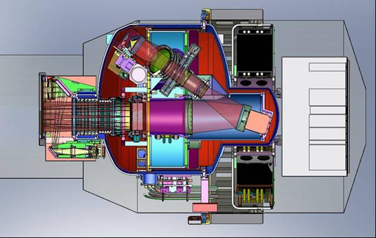
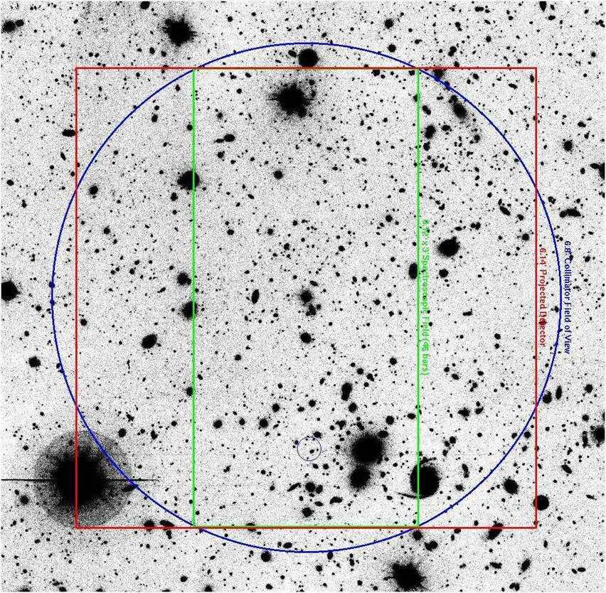
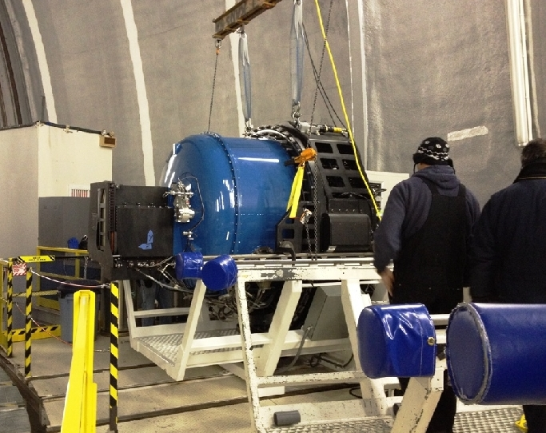

# MOSFIRE: The Multi-Object Spectrograph for InfraRed Exploration

| Email Contact: | [mosfire_info@keck.hawaii.edu](mailto:mosfire_info@keck.hawaii.edu) |
| -------------- | ---------------------- |
| Instrument Scientist: | Josh Walawender |
| Deputy Instrument Scientist: | Leo Alcorn |

## Instrument Description

MOSFIRE is a NIR multi-object spectrograph in operation at the Cassegrain focus of the Keck I telescope since 2012. MOSFIRE was designed and built by a collaboration among UCLA, CIT, and UCSC under the direction of co-Principal Investigators Ian McLean and Chuck Steidel. Notable features of MOSFIRE include:

- 6.1' x 6.1' field of view
- Teledyne H2RG HgCdTe detector with 2K x 2K pixels
- Up to 46 slits using a unique cryogenic robotic slit mask system that is reconfigurable electronically in under 5 minutes

> MOSFIRE In Cross Section.

> The above image shows the field of view configuration for MOSFIRE. The Blue circle (6.8 arcmin diameter) represents the 6.8 diameter collimator field of view. The red square (6.12 x 6.12 arcmin) is the detector area. The intersection of the red and blue geometries is the imaging field of view. The green rectangle is the "nominal" spectroscopic field, over which none of the slits would be vignetted. The mask design software has nice tools that will indicate the wavelength coverage for every slit, with the ability to mark a particular wavelengths of interest.

| MOSFIRE Build Team | |
| ------------------ | |
| Co-Principal Investigators: | Ian McLean (UCLA), Chuck Steidel (CIT) |
| Optics Lead: | Harland Epps (UCSC) |
| Instrumentation Lead: | Keith Matthews (CIT) |

- [MOSFIRE References](references.md)

> MOSFIRE landing on the K1 Nas deck. [Keck Newletter Article about MOSFIRE's first light.](http://www2.keck.hawaii.edu/inst/newsletters/Vol13/index.html#mosfire)

