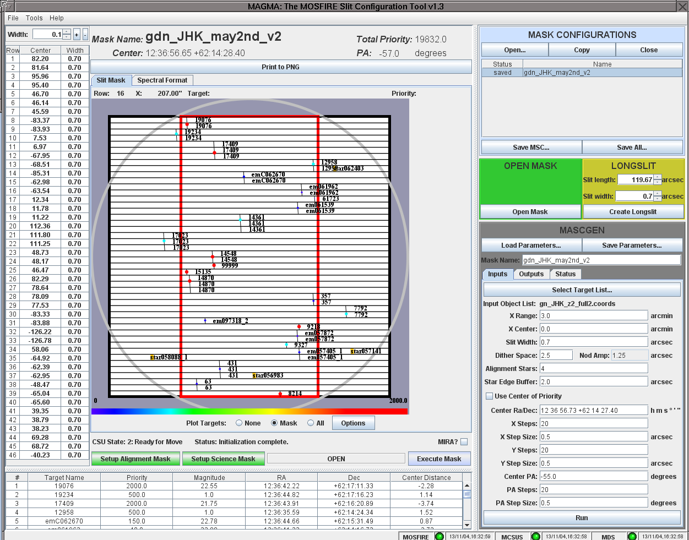

# MAGMA Slitmask Design

MAGMA: MOSFIRE Automatic GUI-based Mask Application, is a tool that is used for several purposes:

1. Designing new slitmask for use with MOSFIRE.
2. Opening previous designs for review and modification.
3. Executing masks when observing (at the telescope only)



Designing masks should be done off line in advance of your observing session. Opening existing designs and modifying them may take place off line or during the observing session. The same software is also used to control the configurable slitmask unit in real time to configure a mask during the night. Unlike LRIS and DEIMOS mask designs, you do not send them to Keck in advance of your run. Instead, you transfer your mask designs to the observing numbered account on the day of your run.

The tool takes as input a list of ranked targets and generates the best mask for a target field given a set of search and mask design criteria that may be modified.

An on-line help is accessible after starting the MAGMA software by clicking the Help option on the right of the top menu-bar. The on-line help documentation explains the software in more detail and gets new mask designer's started. Included in the help pages are descriptions of:

- Target lists (take this into account before creating your target list)
- Input parameters
- Output files
- MAGMA's layout
- How to modify mask configurations 

The software may be down loaded via the links below.

- macOS / Linux / Solaris (v1.1 released 2012-10-02): [magma_1.1.tar.gz](magma/magma_1.1.tar.gz)
- macOS / Linux / Solaris (v1.0 released 2012-08-07): [magma_1.0.tar.gz](magma/magma_1.0.tar.gz)
- Windows (v1.1 released 2012-10-02): [magma_1.1.zip](magma/magma_1.1.zip)
- Windows (v1.0 released 2012-08-07): [magma_1.0.zip](magma/magma_1.0.zip)

# Known Issues

### MAGMA Localization

It has been brought to our attention that there is a possible point of confusion when using MAGMA with certain localization options set on your computer.

MAGMA uses the decimal separator specified by the settings on the computer (. in the US, but which may be , for others), but the example input catalog files use the US standard of the decimal separator. MAGMA users which have European-style localization, should be aware of this possible point of confusion.

### MAGMA "White spaces" error on saving

Observers who have recently updated their MAC OS or JAVA are noticing that MAGMA will not save files correctly. Upon save, the following error is reported:

```
"org.xml.sax.SAXParseException;systemId:http://keck.hawaii.edu/mosfire/msc.xsl;
lineNumber: 1; columnNumber: 50; White spaces are required between publicId and systemId."
```

In addition, the startup script uses `xdpyinfo` which is an X11 script used to determine the monitor screen size. X11 is no longer included with the MAC OS as of Jan 2016. These issues do not appear to prohibit saving *.xml, so these errors are not preventing mask design and creation.

The solutions is to navigate to `Tools` and select `Options`. Uncheck the Write HTML file when saving slit configuration box.  This will allow all of the configuration products for the given slit mask to be written out as desired avoiding the "White spaces.." error message. 
