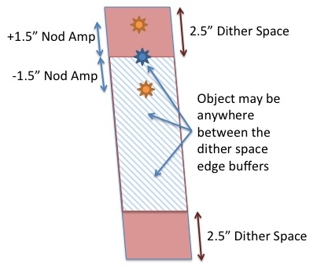

# Mask Design FAQ

### How far in advance must we submit MOSFIRE slitmask design files to Keck?

No advance action is required. You may design masks anytime up until the moment of observation. Downloading mask files from your laptop to the MOSFIRE control computer takes about a minute and is typically done in the afternoon of your observing run in order to acquire calibration images in your slitmask configuration.

### I have questions about designing MOSFIRE masks with the MAGMA GUI. Is any help available?

Help is available by clicking the Help button at the top of the MAGMA GUI window. 

### What are the various fields in the MAGMA target list?

Currently, the list includes the following fields:

- Target Name. No spaces allowed.
- Priority. The priority code is used by MAGMA to determine which objects are assigned to slits in the case when the target list includes more objects than can be observed. The scaling of the priority code is arbitrary, but the higher the priority the more likely that the object will be assigned a slit. The "score" of a mask is the sum of the priorities of the individual targets, and MAGMA will attempt to maximize this score by selecting as many high-priority targets as possible. A value of -1 indicates an alignment star.
- Magnitude/Brightness. This field is not used by MAGMA to determine slit assignments. The magnitude field is simply for your reference and can refer to whichever passband is relevant to your program.
- Right Ascension. See MAGMA online help for permissible formats.
- Declination. See MAGMA online help for permissible formats.
- Epoch. Epoch of coordinates.
- Equinox. Equinox of coordinates.
- Proper motion in R.A. Units?
- Proper motion in Declination. Units?

### When designing masks for MOSFIRE, what dither size should I select for dithered observations using MaskNod or ABBA dither pattern?

The dither space is the buffer between the top and bottom edge of a slit where an object may not be placed. The default is 2.5 arcsec, but it can be any size you would like. For point-like sources, the default size is acceptable. The dither space limits the size of the nod amplitude you may choose to ensure good background subtraction during data reduction. You will likely set the nod amplitude large enough to adequately separate the nod positions to prevent overlap in the spectra. At the telescope, the default nod amplitude is listed in MAGMA as 1/2 the dither space, but this may not be optimal. An example is presented in the figure below describing a typical "mask nod" dither sequence.

A 2.5 dither space is defined during the mask design phase, and a nod amplitude of 1.5 arcsec is used during observing. This leaves 1 arcsec of space to the edge of the slit and 3 arcsec between the nod pairs.

The image below shows what could happen if a star is at the edge of the defined dither space and emphasizes why the nod amplitude set for spectroscopic observations must be smaller than the dither space defined in the design phase. 

### What is the optimal star brightness for alignment stars on MOSFIRE masks?

The acceptable brightness range for alignment stars is the magnitude range 16 < J(AB) < 19 (or 15 < J(Vega) < 18). Our default exposure times for mask alignment is to take a 3×7 s image to balance star and sky brightness, especially at the start of the night when sky backgrounds are high. Later in the night, the default may be changed to 2x10s to save time. For stars brighter than the ranges quoted above you will need to reduce the exposure times to avoid saturation which occurs for 12-13 Jmag in the shortest exposures. We find that exposing for a total of ~20 s or longer provides better centroid measurements, and thus, better alignment.

It's likely that your spectral exposures following the alignment images will see persistence, but it should subside quickly. For mor information on persistence see our [persistence web documentation](persistence.md). Our [recommended exposure times page](exposurerecipes.md) lists the sky brightness for imaging mode, which may help you determine how much flux you'll see.

### Does the MAGMA sofware for MOSFIRE slitmask design offer any capability to complete a set of designs automatically given a list of targets?

Unfortunately, there is no option for batch mask design in MAGMA. To design a series of masks for a set of targets, the steps are: design a mask, remove those targets from your list, and re-run. 
