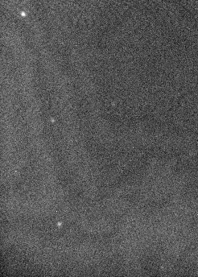

# MOSFIRE News and Status

## Ready for Science (2026-Sep-21)

The leaking He line which caused the previous warmup has been repaired.  One cold head (CH3) has been replaced and the He lines purged.  The instrument is now cold and ready for science.

## Instrument Warmup (2026-Aug-26)

Due to an unexpected cold head failure, MOSFIRE is being warmed for instrument servicing.


## MOSFIRE GUI Tour (2026-May-08)

We have added an [introduction to the GUIs observers will use to 
interact with MOSFIRE](gui_tour.md), including sub-components of the MOSFIRE Desktop.

## Imaging Documentation and DRP Update (2026-March-04)

We have added various updates to the [dither patterns](dither_patterns.md), [observing sequences](observing_sequences.md) pages. These updates provide a link to the MOSFIRE PypeIt documentation for spectroscopic data reduction,
and document imaging mode dither patterns and observing sequences for imaging. 

## CSU Repaired and Fatal Error Statistics (2025-April-29)

The CSU problem described in the previous news item has been fixed. We have tested CSU moves at a variety of elevation and rotator angles and there are indications that the CSU reliability has improved relative to the past.  These tests are time consuming, so this is small number statistics, but it appears that the fatal error occurrence rate is small even at rotator angles of 0 degrees which had been a problem in the past.

| Drive Angle | Elevation=30 | 60   | 80   |
| ----------- | ------------ | ---- | ---- |
| -300        | 0/15         | 0/15 | 0/10 |
| -240        | 0/15         | 0/15 | 0/10 |
| -120        | 0/15         | 0/15 | 0/15 |
| -60         | 0/15         | 0/15 | 0/15 |
| 0           | 0/15         | 0/15 | 1/15 |

>CSU Fatal Error Rate (failures/moves).

## CSU Inoperable (2025-Feb-11)

We have encountered a serious problem with the Cryogenic Slitmask Unit (CSU) and it is currently inoperable. Troubleshooting continues, but a near term fix is looking increasingly unlikely. The CSU is currently fixed in a ~1” wide long slit with an alignment box at the top of the slit. We can use this to do long slit observations with a few manual steps for alignment, but we cannot configure the CSU to other masks (i.e. MOS masks or for imaging). If you have upcoming observing time in February 2025, please consider how you would use your observing time if this situation is not remedied in time.


## FCS Issue Requires Additional Mask Design (2024-Nov-11)

The MOSFIRE Flexure Compensation System (FCS) saturates more often than in the past.  The saturations appear to coincide with cold and warm electronics temperatures.  The FCS correction is elevation and rotator angle dependent.  As a work around, we advise observers to create versions of their slitmasks at their desired PA and also that PA+180 degrees.  These "rotated" mask designs allow FCS to function.  In H- and K-bands, please be aware that the spectral coverage is field-dependent.  That is objects on the left side of the mask have a different wavelength range than those on the right side in H- and K-bands.

## CSU Fatal Errors (2023-Sep-20)

MOSFIRE is experiencing more CSU errors recently. Our mitigation strategies are to move the CSU at EL~67 whenever possible and to minimize (if possible) CSU moves. One option is to take science data using the alignment mask which removes the need to move the bars from alignment to science configuration. This is obviously an impact on the science, so it is up to the observers to decide if the tradeoff is worth it. We don't have great statistics on the fatal errors as they are still a rare occurrence, but in the limited set of incidents we have seen, doing this at low elevation (e.g. EL~35) seems to be problematic. Thus if observers are acquiring a mask at low elevation, we would encourage to either take data in alignment mask, or to minimize the number of alignment stars in the mask to minimize the number of bars moving. If observers chose to carry out observations with alignment masks, it is worth to design science masks exactly the sam as alignment masks, that way there is no need to take separate calibration sets for alignment manually. 

From small number statistics that we gathered in August, CSU errors tend to happen at cos(elevation)*sin(instrument drive angle)>0.4 and cos(elevation)*cos(instrument drive angle)<-0.4. These values correspond to large rX and Y accelerometer values (>6000), where gravity pulls are higher. Avoiding those combinations of elevation and instrument drive angle may help reduce the occurrence of CSU errors.

## Guider Update (2020-Feb-04)

The MOSFIRE guider had been experiencing a failure of one of the amplifiers over the last few months which resulted in the guider field being reduced to half of the normal field of view.  We have replaced the detector in the guider with a spare which has re-enabled the full field of view of the guider.  This change however, has resulted in some fringing effects due to the cover glass on the replacement chip.  This should have no effect in most fields, but extremely faint guide stars may be impacted. We are currently looking to replace the detector with one that does not suffer from fringing, but this may take some time.  A screenshot of the fringing effect can be seen below.


> Example of finging


## MAGMA Localization (2019-Jan-24)

It has been brought to our attention that there is a possible point of confusion when using MAGMA with certain localization options set on your computer.  MAGMA uses the decimal separator specified by the settings on the computer (`.` in the US, but which may be `,` for others), but the example input catalog files use the US standard of the decimal separator. MAGMA users which have European-style localization, should be aware of this possible point of confusion.


## MOSFIRE DRP Version 2018 Released (2018-Jan-05)

The 2018 release of the MOSFIRE DRP is out.  This new version includes an easier installation process, python3 compatibility, and an updated documentation web page, along with numerous other bugfixes and updates.


## MOSFIRE back on-sky and CSU operating normally (2017-Mar-05)

MOSFIRE is on sky, and taking science data as normal. All previous restrictions on CSU motions are no longer an issue. Observers should still be aware, however, avoid configuring the masks which have physical drive angles of 0 or 180 degrees.


## MOSFIRE back on-sky and taking data (2017-Feb-13)

MOSFIRE was returned to science operations on 12 Feb 2017. The performance of MOSFIRE so far appears to be the same as it ever was. Due to weather, we were unable to complete all of the engineering tests we wanted finish, and plan to complete those at a later date. We expect that the throughput and sensitivity of MOSFIRE has not changed.

There is an operational concern with MOSFIRE that observers should watch when observing. The CSU bar positioning is not as reliable and we are finding more bars out of position in images and spectra. Observers should be mindful to check their images and spectra to ensure bars are okay. Please work with your SA to help monitor the bar positions and correct the issue in real time. 

For the time being, we have modified the default rotator angle for acquiring flats to be -10 degrees on the drive angle (formerly -90). Observer should complete major CSU configurations at physical drive angles of 10, -10, -170 or -190 to avoid major CSU faults.

## MOSFIRE DRP Release (2016-Dec-12)

An updated version of the MOSFIRE data reduction package has been released.  This version removes IRAF as a dependency and replaced it with `astropy` and `ccdproc` python packages.

## MOSFIRE Repair Mission Status (2016-Nov-23)

The MOSFIRE repair is planned for completion by late January, 2017 and is expected to be ready for science in the new observing semester beginning February 2017. The MOSFIRE nights currently on the schedule for January 2017 will need to be converted to different instruments and possibly different programs as needed.

The MOSFIRE Dewar was opened in a newly constructed clean room on the dome floor of Keck I in early November.  An optical element in the collimator assembly was found to be dislodged from its mount. The optic was shipped back to UCLA for repair and will be reinstalled by early January. The MOSFIRE Dewar  will then be closed back up, moved up to the Nasmyth deck, pumped and cooled by mid January where it will undergo daytime testing. An engineering night will be used in early Feb to confirm on-sky performance prior to reinstating science operations later in February.

This plan keeps semester 2017A science programs in tact but we'll be working with the institutions and individual PI's to change the remaining MOSFIRE nights in 2016B (January) to other instruments. 

## MOSFIRE out of service and unavailable for science operations (2016-Sept-15)

MOSFIRE was removed from science operations due to a serious problem that is present in the optical system. MOSFIRE will not be available for science use in October, and we anticipate the repair mission lasting a few months. MOSFIRE's image quality is too poor to continue science operations and we are currently scheduling repair activities. The degradation in image quality was induced during engineering activities designed to tune MOSFIRE's rotator bearing. This activity resulted in MOSFIRE vibrating and a loss in the optical alignment. At the present time, there are many variables that remain to be constrained to determine where in the optical path the misalignment occurred, and a deliberate approach is being taken to complete a repair. Thank you for your patience during this unfortunate time while we develop our plan and coordinate a repair mission. Future updates will be posted to the news page as the repair mission progresses.


## Filter wheel one exhibinting a problem (2016-May-25)

Filter wheel 1 has a repeatable failure mode. When we move to or from the J2 filter back to the open position, the filter wheel status goes to unknown. It appears based on the spectra that the filter wheel is in the correct position, but the switches are not read correctly to identify the positon for J2.For most observers, this should not be an issue as filter wheel 2 is the primary wheel that is used. Homing will get the wheel out of trouble, but there are software work arounds we must apply if observers want to use J2 for science. Please consult with you support astronomer if you would like to use a medium band filter like the J2 filter.

## Work around for MAGMA saving error (2016-May-18)

A couple of possible solutions to the problem described in the previous news item documenting a MAGMA error are
- Access from the menu bar Tools -> Options and deselect the first box "Write HTML file when saving slit configuration."
- To run magma offline with Java version 1.6. A handful of observers had had success with this workaround. We are working toward updating MAGMA and will resolve this bug in the next release.


## MAGMA experiencing an error on saving (2016-Apr-26)

Observers who have recently updated their MAC OS or JAVA are noticing that MAGMA will not save files correctly. Upon save, the following error is reported:

```"org.xml.sax.SAXParseException;systemId:http://keck.hawaii.edu/mosfire/msc.xsl; 
lineNumber: 1; columnNumber: 50; White spaces are required between publicId and systemId."```

In addition, the startup script uses xdpyinfo which is an X11 script used to determine the monitor screen size. X11 is no longer included with the  MAC OS as of Jan 2016. These issues do not appear to prohibit saving *.xml, so these errors are not preventing mask design and creation.

## Older News Items

For older news items, see the [news archive](newsarchive.md).
