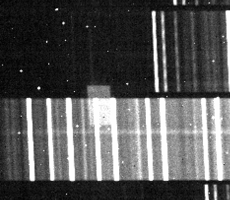
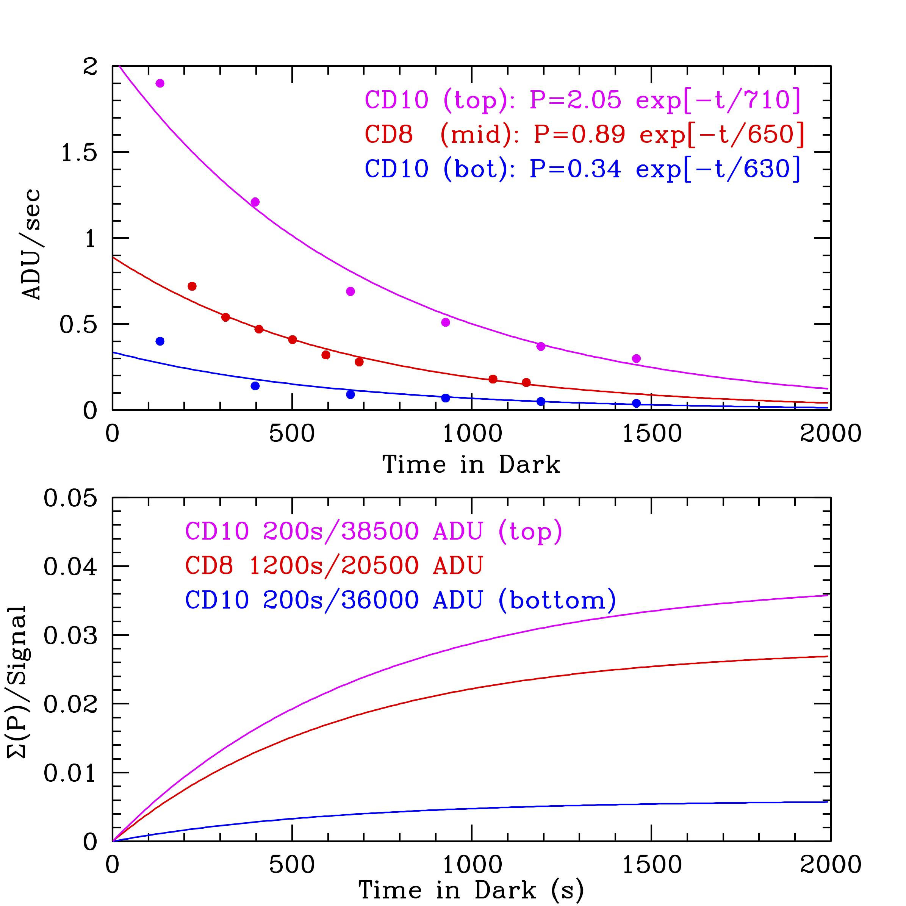

# Detector Persistence

When relatively bright sources are detected, observers can very
easily see persistence in the images and spectra:

- The first few spectroscopic frames acquired after a mask alignment typically show persistence at locations where the slits and boxes of the mask were imaged during mask alignment.
- As a second example, observers may see the residual persistence in the spectroscopic data of OH lines from the last observed mask for the first 15-20 min.

Acquiring spectra using a dither pattern such as `MaskNod` or `ABBA` helps characterize the persistence problem and reduces the impact in the reduced data. Because the persistence depends strongly on the intensity level and less on the duration of the photon accumulation, the best (and only) way to avoid persistence is to keep the detector unexposed to bright sources whenever possible.

## Appearance of Persistence

The image below is an example of what observers will most likely notice for the first 10-15 minutes of a spectroscopic observation sequence after a series of alignment images or other observations involving direct imaging.  Since the imaging mode and spectroscopic modes introduce small relative shifts of the positions of slits on the detector, the residuals of imaged slits and/or alignment boxes will appear slightly rotated and offset from the corresponding dispersed spectra. Depending on the length of a slit and position of an alignment box, this may result in residual boxes that overlap two spectra as is the case in the following image.

The persistent signal decays exponentially with a timescale of ~10-12 minutes until it asymptotically approaches an integrated signal ranging from 0.6 to 3.5% of the stimulus signal over time, Because it is slowly varying, it will likely go unnoticed for short integrations times and in differences of frames taken over time intervals of much less than the e-folding time. For a decay time constant of ~11 min (see the plots below), observers can expect the persistence intensity will drop to less than 5 percent of the peak in 33 min or to less than 1% in 51 min. 

The plots above indicate two datasets acquired during to different cool downs (CD) while MOSFIRE was at Caltech. CD8 corresponds to a initial 1200s K-band spectrum of pinhole mask, followed by a series of 59.7s exposures at 93s intervals with an initial signal level of 20500 ADU. CD10 corresponds to an initial 200s H-band image of a slitmask, followed by a series of 199.3s exposures at 265s intervals. For the CD10 series, two regions near the top and bottom were analyzed. The initial signal level at the top are probably saturated (signal level indicated 38,500 ADUs) while the bottom signal level was 35600 ADUs. Note that the plots show the signal rate and not the total signal detected. The time for each point is relative to the middle of the exposures. The bottom graph shows the cumulative signal level as a percentage of the initial signal level. 

## Spatial Variation in Persistence Susceptibility

Note that the CD10 measurements in the previous plot (magenta and blue lines) are derived from the same set of images and yet exhibit a factor of almost 10 difference in the amplitude of the persistence (even though they show similar time constants). Both plots clearly show that the bottom part of the detector is less susceptible to persistence. Although the detector was exposed to the same intensity of light on both the top and bottom, the initial persistence charge is less at the bottom by a factor of six, relative to the top.

Observers with programs that could be adversely affected by persistence may this wish to consider (e.g.) moving their long-slit configuration to the bottom half of the MOSFIRE detector (as seen on the ds9 display), as the persistence is a factor of ~6 smaller and has a slightly shorter time constant for decay. This is easily accomplished by aligning the object in the longslit and then sending it to the bottom half using the sltmov command.