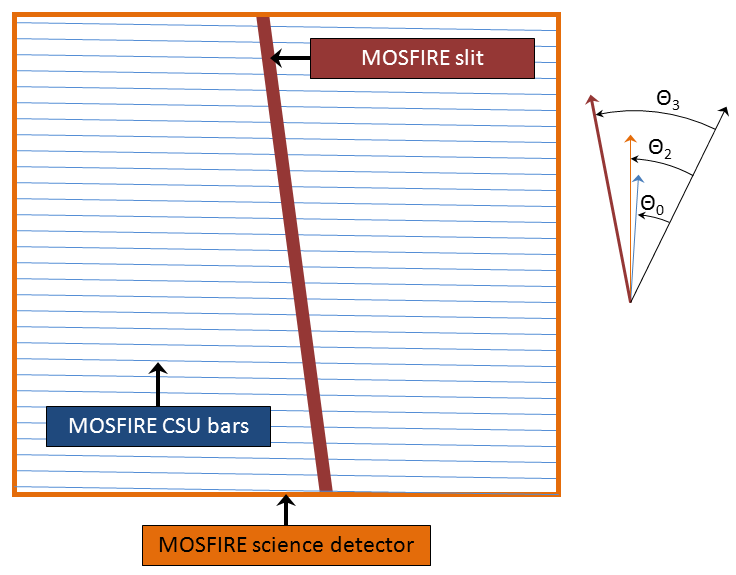

# Positions Angles

The MOSFIRE observer must be aware not only of the position angle of the instrument, but also what that position angle refers to. There are several position angles pertinent to MOSFIRE, as described in the table below. 

| Keyword | Description | Value for ROTDEST=0 | Relation to ROTDEST |
| ------- | ----------- | ------------------- | ------------------- |
| SKYPA0  | Position angle of a vector normal to the CSU  bars relative to celestial North.   Note: Contrary to standards proposed in  KSD 40 which stipulate that ROTPOSN is  defined by the guider, the CSU normal  vector is accepted as the fundamental  definition of the position angle on MOSFIRE.  MAGMA specifies this PA for slitmasks. | 0.00 | ROTDEST=SKYPA0 |
| SKYPA1  | Position angle of MOSFIRE guider detector  columns relative to celestial North. | +90.00 | SKYPA1=ROTDEST+90.00 ROTDEST=SKYPA1-90.00 |
| SKYPA2  | Position angle of MOSFIRE science detector  columns relative to celestial North. | +0.22 | SKYPA2=ROTDEST+0.22 ROTDEST=SKYPA2-0.22 |
| SKYPA2  | Position angle of MOSFIRE longslit relative  to celestial North. | +4.00 | SKYPA3=ROTDEST+4.00 ROTDEST=SKYPA3-4.00 |

The image below (which is not to scale) depicts the relationships orientation of the various MOSFIRE components. 

Notes:

- The tan outline represents the MOSFIRE detector.
- The thin blue lines represent the MOSFIRE CSU bars. Note that the bars are tilted by 0.22° relative to the MOSFIRE detector rows.
- The thick red line represents the MOSFIRE longslit (as well as any individual MOSFIRE slit). Note that the longslit is tilted by 4° relative to a vector normal to the CSU bars, and by 3.78° relative to the MOSFIRE detector columns.

Notes for the Legend:

- The black vector represents celestial North.
- The angle labeled &Theta;0 represents the position angle of the CSU relative to North (i.e., SKYPA0 or ROTPOSN).
- The angle labeled &Theta;2 represents the position angle of the MOSFIRE detector relative to North (i.e., SKYPA2).
- The angle labeled &Theta;3 represents the position angle of the MOSFIRE longslit relative to North (i.e., SKYPA3).

## Applications

- Slitmask position angle: To orient the CSU at a particular position angle relative to celestial north, simply set the MOSFIRE position angle (DCS keyword ROTDEST) to that value. Example: To put North "up" relative to the CSU bars, set ROTDEST to 0.
- Imaging position angle: To orient the MOSFIRE detector at a particular position angle relative to celestial north, set the MOSFIRE position angle (DCS keyword ROTDEST) to that value minus 0.22. Example: To put North "up" on the image, set ROTDEST to -0.22.
- Longslit position angle: To orient the MOSFIRE longslit at a particular position angle relative to celestial north, set the MOSFIRE position angle (DCS keyword ROTDEST) to that value minus 4.00. Example: To orient the longslit north/south, set ROTDEST to -4.00. 
