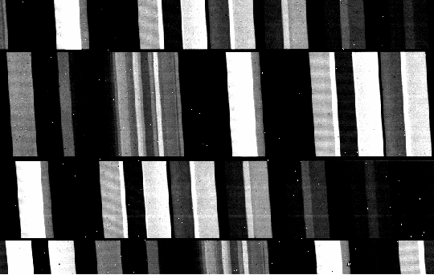
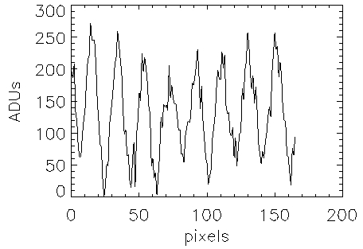
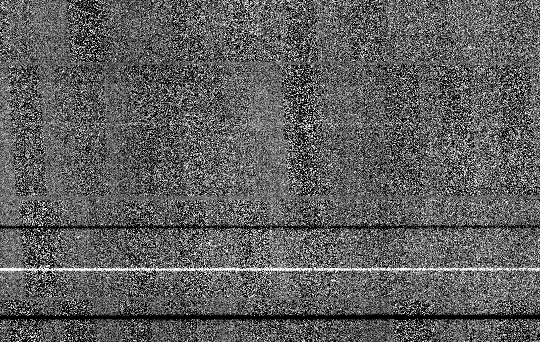
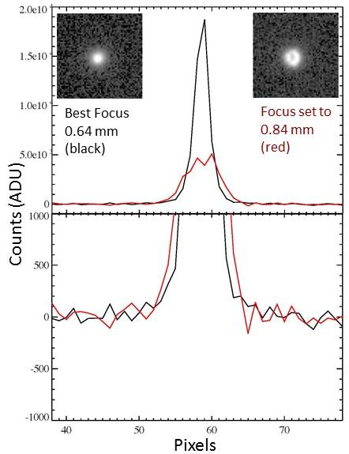

# Spectrophotometric Observing and Calibration Strategies and Fringing

## Observing Strategies

Observers attempting high-precision spectrophotometry with MOSFIRE should understand that there are a couple of limiting factors:

- The CSU bars can be repositioned to an accuracy of 0.02 arcsec on the sky.
- Fringing is present in the night sky lines.

However, observers can achieve higher precision by following the strategies described below. These recommendations were developed for observations of relatively bright stars (K = 6-10 mag) and address mitigation of CSU motion, fringing, and saturation issues.

If you have questions, contact your support astronomer.

These strategies are based on feedback from observing teams, with special thanks to Drs. Ian Crossfield and Avi Mandell. Additional details are available in Appendix A of [Warm Ice Giant GJ 3470b](http://arxiv.org/abs/1308.6580).

### 1. Obtain Dome Flats Immediately Before or After Science Exposures

- Do not move the CSU bars between calibrations and science exposures.
- CSU bar positions are repeatable to 0.02 arcsec on the sky (McLean et al. 2012), corresponding to roughly 3% of a typical 0.7 arcsec slit.

Example two-mask observing sequence:

1. Acquire arcs and flats with the first mask in the afternoon.
2. Focus using Autofoc (see below).
3. Acquire science observations with the first mask.
4. Configure the CSU for the second mask.
5. Acquire science observations with the second mask.
6. In the morning, acquire arcs and flats with the second mask.

### 2. Use Autofoc Instead of MIRA

- Inform the OA and SA that Autofoc is required.
- MIRA moves the CSU bars because MOSFIRE imaging is used to measure telescope focus.
- Autofoc determines focus using the guide camera and avoids CSU motion.
- Autofoc provides adequate focus quality for spectrophotometric observations.

### 3. Avoid Placing Targets at CSU-Bar Boundaries

- Center the target between the circular region markers displayed in ds9.
- The green circles mark the middle edges of the slit.
- Use the `nbfilt` command-line script to image the field and avoid detector persistence caused by over-illumination.

### 4. Nod the Telescope During Spectroscopic Observations

- Use the standard observing pattern `mask-nod`.
- Nod the telescope by a few arcseconds between exposures.
- Pair subtraction of the two nod positions minimizes fringing effects.

See the Fringing section below.

### 5. Defocus the Telescope

- Set the telescope focus to **+200 microns** relative to best focus.
- Set the guider focus to **13.8** (nominal value is 14.0).
- This can improve observing efficiency by reducing saturation in short exposures.

See telescope defocusing below.

## Calibrations

Acquiring calibrations for wide slits (> 2.0 arcsec) is a manual procedure.

It is recommended that two versions of the slitmask be prepared:

1. A science mask with 10-15 arcsec wide slits.
2. A second mask with the same geometry but narrow (0.7 arcsec) slits.

The narrow-slit mask is used to obtain arc-lamp exposures for deriving a wavelength solution. These calibrations are acquired in the same way as normal masks.

Wide-slit masks require flats to be acquired manually. See the [Exposure Recipes](exposure_recipes.md) page for acquisition procedures.

## Fringing

Fringing in MOSFIRE spectroscopy was first identified by Dr. Ian Crossfield and collaborators. Observers detect fringing in night-sky emission lines when using relatively large slits (greater than 2.0 arcsec).

In K band, fringe amplitudes can reach approximately 4 ADU/s/arcsec. The amplitude, spatial frequency, orientation, and phase vary both spatially and temporally.

Fringing is particularly problematic for fixed-position ("stare mode") observations. Because Keck's nodding precision is highly accurate and repeatable, nodding observations significantly reduce fringing effects.

### Example Fringing Image

The image below shows four wide slits. Because the slit width was 15 arcsec, the night-sky emission lines appear as parallelograms. The sinusoidal variations along the spatial direction are the fringing pattern.

### Fringe Line Profile

The plot below illustrates fringing along a bright night-sky emission line.

Monochromatic OH emission lines may produce fringing with amplitudes on the order of 50 ADU peak-to-valley. The example shown exhibits an amplitude of approximately 250 ADU.

### Fringe Removal by Nodding

The image below shows a differenced nod pair. Fringing is largely removed through pair subtraction, while object spectra remain visible.

## Telescope Defocusing

On 31 August 2013, images of a PSF star were acquired with telescope focus ranging from the optimal focus (0.64 mm) to a defocused value of 1.14 mm.

Analysis by Dr. Avi Mandell showed that when the telescope is defocused by **+200 microns**:

- Peak flux decreases by approximately two-thirds.
- The PSF broadens by roughly a factor of 2.5.
- The PSF develops only a slight donut shape.
- The resulting profile is largely flat-topped.

### Conclusion

Defocusing the telescope by **+200 microns** can improve observing efficiency without significantly affecting high-precision spectrophotometric observations.

### Recommended Guider Focus Settings

| Telescope Focus Offset (µm) | Guider Focus |
|----------------------------:|-------------:|
| Optimal | 14.00 |
| +100 | 13.90 |
| **+200** | **13.80** |
| +300 | 13.64 |
| +400 | 13.54 |
| +500 | 13.46 |

The **+200 micron** telescope focus offset with a guider focus of **13.80** is recommended.
