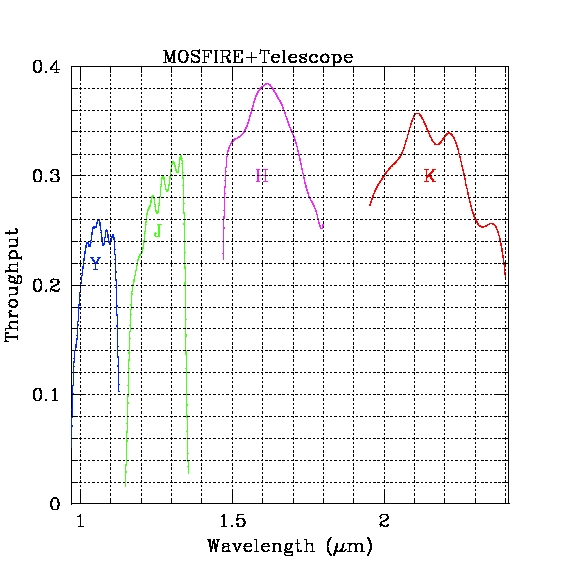

# Measured Spectroscopic Throughput

Below are documents that describe the throughput for MOSFIRE. The throughputs are based on on-sky measurements of standards acquired in May 2012. In general, the measured and predicted throughput are in good agreement.

The throughput of the instrument includes the throughput of common optical elements, configurable elements, and the detector QE. For each graph, the throughput for:

- Instrument only
- Instrument + telescope
- Total throughput from the top of the atmosphere

are plotted.

## Broad Band Filters

| Filter | Throughput |
|--------|------------|
| Y Spec | [Plot](figures/MosfireEff.Yspec.jpg) [Data](figures/Yeff_mosfire+tel.dat) |
| J Spec | [Plot](figures/MosfireEff.Jspec.jpg) [Data](figures/Jeff_mosfire+tel.dat) |
| H Spec | [Plot](figures/MosfireEff.Hspec.jpg) [Data](figures/Heff_mosfire+tel.dat) |
| K Spec | [Plot](figures/MosfireEff.Kspec.jpg) [Data](figures/Keff_mosfire+tel.dat) |
| Ks Band (prediction only) | [Data](figures/Ks_tp_tot.txt) |

## Throughput for All Filters

Throughput for all filters is provided as a means of comparing the relative throughput for all broad band filters.

## Spectroscopic Sensitivities

The exposure time calculator, [XTcalc](xtcalc.md), incorporates the throughput measurements above and is recommended for estimating the observing time required to achieve specific science goals.
