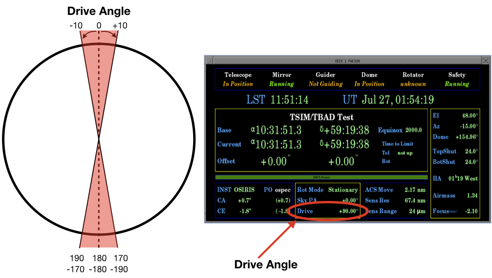
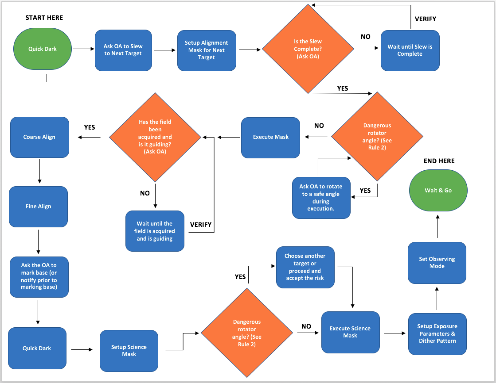
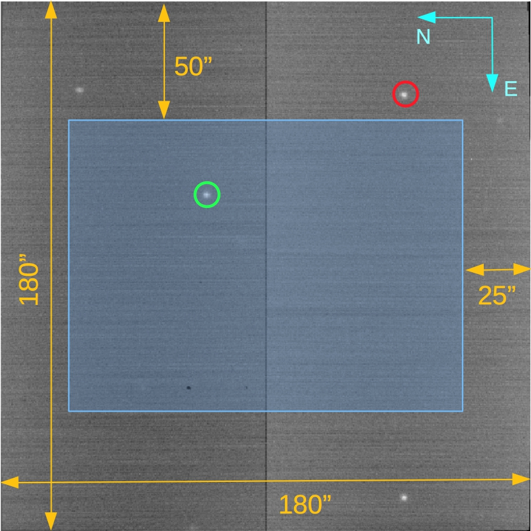

# MOSFIRE Observing Workflow

## The Two Habits of Highly Successful MOSFIRE Observers

There are two rules which all MOSFIRE observers are encouraged to follow. Both motivated by properties specific to the instrument: 

#### 1) When in doubt, go dark!

MOSFIRE's H2RG detector has image persistence (like many other similar detectors). To minimize the possibility of this persistence contaminating subsequent exposures, we encourage users to use the Quick Dark button in the MOSFIRE desktop to block light from reaching the detector whenever science exposures are done and some other task is being executed such as a CSU move or a slew. This will prevent bright sky background or star light which is not scientifically useful from generating a persistence effect.

Observers should always remember to select the appropriate observing mode (e.g. "Y Spectroscopy", "J Imaging", etc.) before starting the next exposure.

### 2) Avoid executing a CSU mask at "bad" rotator angles or "small" slit movement when possible.

The MOSFIRE CSU is known to be vulnerable to "CSU Fatal Errors" which can take a very long time to recover from (up to 90 mintes). These errors are generally rare, but are known to be dramatically more likely at rotator angles which place the CSU bars within about 10 degrees of horizontal. These errors can happen when sending small slit movements like from 0.7" to 1.0" slit width or vice versa.

As a result, we strongly recommend that observers not execute a CSU mask within 10 degrees of a multiple of 0 or 180 on the physical drive angle. This is shown as "Drive Angle" on the lower part of FACSUM (just below the reading for the position angle on the sky). In addition, if observers plan to switch between 0.7" and 1.0" width slits, it is recommended to first move to an extra wide slit, for example, from 0.7" to 5.0" then to 1.0" slit to avoid CSU fatal error.

Observers are encouraged to communicate with the OA when they intend to execute a mask. This can be done during a slew, for example, which saves time, but the observer must coordinate with the OA if they intend to execute a CSU move during a slew. The OAs can check whether the rotator will go through a bad angle during a slew and even let an observer know exactly when it becomes safe to execute a mask.

# Observing Sequences

MOSFIRE can seem complicated to run, but most observing cases are variants of a few basic observing sequences. The sections below give generic examples of those observing sequences. Actual conditions or differences between programs may motivate you to observe slightly differently, so these are intended as suggestions, not hard and fast rules. For example, the steps of executing a mask and slewing to a new target can be done simultaneously if the observer coordinates with the OA (see rule 2 above). 

- [MOS Mask Observations](#mos_mask_observations)
- Long Slit or long2pos Observations of Bright Targets
- Imaging Observations

## MOS Mask Observations

You can also use this same sequence for faint targets with a long slit mask.

1. Go dark by clicking the Quick Dark button in the MOSFIRE Desktop
2. Ask your OA to slew to next target
3. Setup alignment mask for next target
4. Execute mask.  You must check with your OA about executing a mask while slewing or wait until slew is complete before executing the mask.
5. Perform [Coarse alignment](maskalignment.md) (can be done while mask is executing)
    - You must wait for the OA to indicate that they have acquired the field and are guiding before you coarse align.
    - You may coarse align while the CSU is still executing a mask because this step only uses the guider, not the main instrument.
6. Perform [Fine alignment](maskalignment.md)
7. Mark base. This can be accomplished by either asking your OA to mark base or by typing markbase in a terminal which is logged in to mosfireserver (please let your OA know if you do this).
8. Go dark by clicking the Quick Dark button in the MOSFIRE Desktop.
    - You can save some time by going to the dark mode of your designed science mode (e.g. if you are doing K-band spectroscopy next, got o K-dark spectroscopy mode).
9. Setup science mask
10. Execute science mask
    - If, after aligning the mask, you are in one of the dangerous rotator angles noted above in Rule 2, you have a choice between executing the mask despite the additional risk or choosing a different target.
    - Fortunately, the CSU bar moves to go between an alignment mask and the corresponding science mask are usually small, so the risk of a fatal error is not as large as it would be if all the CSU bars were moving, but it is still elevated. Most observers opt to accept the additional risk and make this CSU move.
11. Set up exposure parameters and [dither pattern](ditherpatterns.md). This can be done while the CSU is moving.
    - Fill out the exposure parameters section of the MOSFIRE desktop GUI. Recommended exposure times and parameters are listed here.
        - Object and comment fields. These are for the FITS header.
        - Integration time in seconds.
        - Number of coadds (typically 1 for spectrocopy)
        - Sampling mode and number of reads (typically MCDS and 16 for spectroscopy)
        - Number of repeats
        - Select the [dither pattern](ditherpatterns.md) (e.g. "mask nod" or "ABBA")
        - Verify that the dither params match your mask design
    - Note that an estimate of the total clock time that a sequence will take (including overheads) is shown at the bottom of the window. After changing a parameter, be sure to click in a new box to make sure the value is recalculated with the new parameters.
12. Set observing mode. Choose a mode from the MOSFIRE desktop (e.g. "Y Spectroscopy") to allow light back in to the instrument.
13. Wait & Go. You can click the Wait & Go button in the MOSFIRE desktop while the mechanisms are still moving to your chosen observing mode. As soon as the mechanism moves finish the instrument software will start your observing sequence.

A slightly simplified version of the above process can be seen in the flow chart below. A big thanks to MOSFIRE observer Becky Steele for generating this diagram.

## Long Slit or long2pos Observations of Bright Targets

Note: if you are using the long2pos mask, make sure you have loaded the mask files using the [long2pos instructions](long2pos.md).

1. Go dark by clicking the Quick Dark button in the MOSFIRE Desktop
2. Ask your OA to slew to next target
3. Setup mask
    - For long slit: Setup alignment mask.
    - For long2pos: Setup science mask.
4. Execute mask
    - You must check with your OA about executing a mask while slewing or wait until slew is complete before executing the mask.
5. Perform [Fine alignment](maskalignment.md)
    - Use the "Bright Long" tab in the SAT for alignment.
    - Note, we have skipped the guider coarse align step because if your target in a single compact source which is bright enough to be seen in the guider image, the OA will center it in the guider before sending it to the instrument pointing origin.
    - If you do not see your target in the alignment image in the SAT, then go back and perform a coarse align.
6. Mark base. This can be accomplished by either asking your OA to mark base or by typing markbase in a terminal which is logged in to mosfireserver (please let your OA know if you do this).
7. Go dark by clicking the Quick Dark button in the MOSFIRE Desktop.
    - You can save some time by going to the dark mode of your designed science mode (e.g. if you are doing K-band spectroscopy next, got o K-dark spectroscopy mode).
8. **For long slit only** (skip for long2pos): Setup science mask
9. **For long slit only** (skip for long2pos): Execute science mask
    - If, after aligning the mask, you are in one of the dangerous rotator angles noted above in Rule 2, you have a choice between executing the mask despite the additional risk or choosing a different target.
    - Fortunately, the CSU bar moves to go between an alignment mask and the corresponding science mask are usually small, so the risk of a fatal error is not as large as it would be if all the CSU bars were moving, but it is still elevated. Most observers opt to accept the additional risk and make this CSU move.
10. Set up exposure parameters and [dither pattern](ditherpatterns.md). This can be done while the CSU is moving.
    - Fill out the exposure parameters section of the MOSFIRE desktop GUI. Recommended exposure times and parameters are listed on the [exposure recipes page](exposurerecipes.md).
        - Object and comment fields. These are for the FITS header.
        - Integration time in seconds.
        - Number of coadds (typically 1 for spectrocopy)
        - Sampling mode and number of reads
        - Number of repeats
        - **For long slit only**: Select the [dither pattern](ditherpatterns.md) (e.g. "mask nod" or "ABBA")
    - Note that an estimate of the total clock time that a sequence will take (including overheads) is shown at the bottom of the window. After changing a parameter, be sure to click in a new box to make sure the value is recalculated with the new parameters.
11. Set observing mode. Choose a mode from the MOSFIRE desktop (e.g. "Y Spectroscopy") to allow light back in to the instrument.
12. Execute Observation (see commands for long slit vs. long2pos below)
    - **For long slit**: Click Wait & Go
    - **For long2pos**: Click Apply (available in the same pull down menu as Wait & Go)
        - Coordinate with the OA to make sure the guide star is not too close to the edge of the guider field of view (see figure below). If there is no appropriate guide star, you have the option of: 1) doing the observation without guiding which should be fine for short exposures, 2) trying to find another guide star at a different rotator angle, or 3) trying another target.
        - Launch the datataking script from the background menu via: `MOSFIRE Utilities > Spectrophotometric Observations > Acquire spectra with long2pos mask`. You can invoke the same script from the command line with `acq_long2pos`.

## Imaging Observations

1. Go dark by clicking the Quick Dark button in the MOSFIRE Desktop
2. Ask your OA to slew to next target
3. Setup open mask
4. Execute mask
    - You must check with your OA about executing a mask while slewing or wait until slew is complete before executing the mask.
5. Set up exposure parameters and [dither pattern](ditherpatterns.md). This can be done while the CSU is moving.
    - Fill out the exposure parameters section of the MOSFIRE desktop GUI. Recommended exposure times and parameters are listed on the [exposure recipes page](exposurerecipes.md).
        - Object and comment fields. These are for the FITS header.
        - Integration time in seconds.
        - Number of coadds (often >1 for imaging)
        - Sampling mode and number of reads
        - Number of repeats
        - Select the [dither pattern](ditherpatterns.md) (e.g. "box4" or "box9")
    - Note that an estimate of the total clock time that a sequence will take (including overheads) is shown at the bottom of the window. After changing a parameter, be sure to click in a new box to make sure the value is recalculated with the new parameters.
    - Some observers prefer to use command line to run imaging dither patterns. To prepare for this, set up the exposure as above for the MOSFIRE Desktop GUI, and click Apply (available in the same pull down menu as Wait & Go). Then manually set dither parameters:
        - Open a mosfireserver login window from the background menu.
        - Input: `modify -s mosfire node=[input RA dither in arcseconds]`
        - Input: `modify -s mosfire nodn=[input Dec dither in arcseconds]`
6. Set observing mode. Choose a mode from the MOSFIRE desktop (e.g. "Y Imaging") to allow light back in to the instrument.
7. Wait & Go
    - You can click the Wait & Go button in the MOSFIRE desktop while the mechanisms are still moving to your chosen observing mode. As soon as the mechanism moves finish the instrument software will start your observing sequence.
    - If using command line, type in the name of your dither pattern: box9, box5, or box4. This will begin observations immediately so wait until your observing mode is complete before executing the command line script. 
